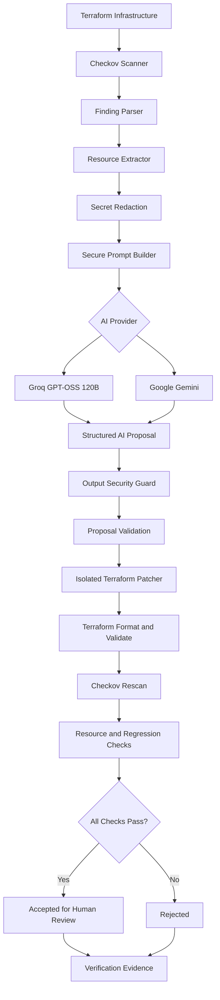

# AI-Assisted Terraform Security Gate

[](https://github.com/Shakthii005/AI-Assisted-Terraform-Security-Gate/actions/workflows/terraform-security-gate.yml)

**AI-powered Infrastructure-as-Code security remediation with independent Terraform and Checkov verification.**

## Overview

The AI-Assisted Terraform Security Gate is a Python-based security automation project that detects AWS infrastructure misconfigurations in Terraform code, generates AI-assisted remediation proposals, and independently verifies the proposed changes before accepting them for human review.

It integrates Terraform, Checkov    , Groq and Google Gemini into a controlled security workflow.

**The core principle: Never trust an AI-generated infrastructure change without independent security verification.**

The AI model does not directly edit original Terraform files, execute shell commands or deploy infrastructure. Every proposal is treated as untrusted input.

## The Problem

Infrastructure teams use Terraform to provision cloud resources. Small configuration mistakes can expose sensitive infrastructure.

Examples include:

- Security groups allowing SSH from the entire internet.
- EC2 instances allowing IMDSv1.
- S3 buckets without required encryption.
- Publicly accessible RDS databases.
- IAM policies granting unrestricted wildcard permissions.

Traditional security scanners identify these issues, but developers must still understand and implement the fixes.

This project adds an AI-assisted remediation layer while retaining deterministic security verification.

## How It Works

1. **Scan:** Checkov scans Terraform infrastructure and identifies security findings.
2. **Extract:** Python extracts the affected resource and surrounding context.
3. **Protect:** Sensitive values are redacted and source-derived content is treated as untrusted input.
4. **Generate:** Groq or Gemini proposes a Terraform remediation using structured JSON.
5. **Validate:** Application-side security guards inspect the AI-generated proposal.
6. **Patch:** The validated proposal is applied to a separate Terraform workspace.
7. **Verify:** Terraform and Checkov independently validate the patched infrastructure.
8. **Enforce:** The baseline gate rejects newly introduced security findings.
9. **Review:** Successful proposals are marked `ACCEPTED_FOR_HUMAN_REVIEW`.

## Architecture



For the detailed component architecture, see [docs/architecture.md](docs/architecture.md).

## Technology Stack

| Technology | Purpose |
|---|---|
| Python 3.13 | Security automation and orchestration |
| Terraform | Infrastructure as Code |
| Checkov 3.4.0 | Infrastructure security scanning |
| Groq API | AI remediation using GPT-OSS 120B |
| Google Gemini API | Alternative AI remediation provider |
| Google GenAI SDK | Gemini integration |
| Pytest | Automated testing |
| GitHub Actions | Continuous integration |
| GitHub Branch Protection | Protected repository changes |
| JSON and CSV | Security reports and model evaluation |

## Security Features

### 1. AI Output Validation

AI responses are not trusted automatically.

The project validates:

- Required JSON structure.
- Terraform resource identity.
- Sensitive-value placeholders.
- Recognizable hardcoded credentials.
- Prohibited Terraform constructs.
- Dangerous public ingress patterns.
- Wildcard IAM permissions.

### 2. Secret Redaction

Sensitive Terraform assignments are redacted before sending prompts to external AI providers.

Recognized placeholders are restored locally when preparing the temporary Terraform patch.

### 3. Isolated Patching

AI proposals are applied only to temporary infrastructure copies under:

`eval/work/`

Original Terraform source files are not modified by the AI remediation process.

### 4. Independent Verification

Every accepted proposal must pass:

| Verification | Purpose |
|---|---|
| Terraform fmt | Formatting validation |
| Terraform init | Provider initialization without backend |
| Terraform validate | Terraform configuration validation |
| Checkov rescan | Infrastructure security verification |
| Target finding check | Confirms intended finding is resolved |
| Regression check | Prevents newly introduced Checkov findings |
| File-scope validation | Restricts modified Terraform files |
| Resource-scope validation | Restricts infrastructure changes |

Acceptance requires every verification condition to pass.

### 5. Baseline-Aware Enforcement

The project compares current Checkov findings against an approved baseline.

| Finding type | Decision |
|---|---|
| New finding | FAIL |
| Unchanged finding | PASS |
| Resolved finding | PASS |

Finding identities use Checkov ID, Terraform resource and normalized file path, rather than source line numbers.

Pull requests use the baseline from their target branch, preventing a proposed baseline change from hiding newly introduced findings.

## AI Models Evaluated

| Provider | Model |
|---|---|
| Groq | `openai/gpt-oss-120b` |
| Google Gemini | `gemini-3.6-flash` |

The evaluation engine sends identical prompts to both providers and records their remediation and verification results.

See [Model Evaluation](docs/model-comparison.md)

## Evaluation Results

Five AWS Terraform security scenarios were evaluated using both models.

| Security scenario | Checkov ID | Groq | Gemini |
|---|---|---|---|
| Unrestricted SSH access | CKV_AWS_24 | Accepted | Accepted |
| EC2 IMDSv2 | CKV_AWS_79 | Accepted | Accepted |
| S3 KMS encryption | CKV_AWS_145 | Accepted | Accepted |
| RDS public accessibility | CKV_AWS_17 | Accepted | HTTP 503 |
| IAM least privilege | CKV_AWS_62 | Accepted | Accepted |

### Quantitative Results

| Metric | Groq | Gemini |
|---|---:|---:|
| Evaluation attempts | 5 | 5 |
| Proposals generated | 5 | 4 |
| Accepted proposals | 5 | 4 |
| Generation success rate | 100% | 80% |
| Acceptance when generated | 100% | 100% |
| New Checkov finding identities | 0 | 0 |
| Resolved Checkov finding identities | 13 | 12 |
| Average generation latency | 2.94 sec | 9.92 sec |

The Gemini RDS request failed because the provider returned HTTP 503 UNAVAILABLE due to temporary service overload. This was classified as a generation failure, not a rejected Terraform remediation.

Across the four paired scenarios where both models generated proposals, Groq was approximately 3.36 times faster.

These are preliminary results from five single-run scenarios, not a statistically conclusive benchmark.

### Test Results

- 79 Python tests passed.
- Nine successfully generated proposals passed independent verification.
- No new Checkov finding identities were introduced by accepted proposals.
- Three GitHub Actions required checks passed during the Day 9 pull request.

Evaluation evidence is preserved in:

`eval/compliance-evidence/model-comparison/`

## Compliance Control Alignment

The project maps selected technical security scenarios to AWS Security Hub CSPM and NIST SP 800-53 Rev. 5 references.

| Checkov finding | AWS Security Hub control | NIST alignment |
|---|---|---|
| CKV_AWS_24 | EC2.53 | SC-7 |
| CKV_AWS_79 | EC2.8 | AC-3, AC-6 |
| CKV_AWS_145 | S3.17 | SC-13, SC-28 |
| CKV_AWS_17 | RDS.2 | AC-4, SC-7 |
| CKV_AWS_62 | IAM.1 | AC-6 |

These mappings demonstrate selected technical control alignment, not formal compliance or certification.

See [docs/compliance-mapping.md](docs/compliance-mapping.md) for control references, evidence and limitations.

## Repository Structure

```text
AI-Assisted Terraform Security Gate/
│
├── .github/
│   └── workflows/
│       └── terraform-security-gate.yml
│
├── infra/
│   └── Terraform infrastructure test configurations
│
├── gate/
│   ├── scanner.py
│   ├── extract.py
│   ├── prompts.py
│   ├── config.py
│   ├── llm.py
│   ├── gemini_llm.py
│   ├── remediate.py
│   ├── redaction.py
│   ├── output_guard.py
│   ├── patcher.py
│   ├── verify.py
│   ├── diff_guard.py
│   ├── finding_identity.py
│   ├── baseline_gate.py
│   └── evaluate_models.py
│
├── tests/
│   └── Python unit and integration tests
│
├── eval/
│   ├── baseline.json
│   ├── proposals/
│   ├── work/
│   └── reports/
│
├── docs/
│   ├── architecture.md
│   ├── compliance-mapping.md
│   ├── threat-model.md
│   └── model-comparison.md
│
├── requirements.txt
├── requirements-dev.txt
├── .gitignore
└── README.md
```

## Getting Started

### Prerequisites

Install:

- Python 3.13 or compatible version.
- Terraform CLI.
- Git.
- Visual Studio Code or another Python editor.
- Groq API key.
- Gemini API key (optional if only using Groq).

No AWS deployment or AWS credentials are required for the local Terraform validation and Checkov evaluation workflow.

### 1. Clone the Repository

```bash
git clone https://github.com/Shakthii005/AI-Assisted-Terraform-Security-Gate.git

cd AI-Assisted-Terraform-Security-Gate
```

### 2. Create a Virtual Environment

Windows PowerShell:

```powershell
python -m venv .venv

.\.venv\Scripts\Activate.ps1
```

### 3. Install Dependencies

```powershell
python -m pip install --upgrade pip

python -m pip install -r requirements-dev.txt
```

Check compatibility:

```powershell
python -m pip check
```

### 4. Configure API Keys

Create a `.env` file in the project root:

```env
LLM_PROVIDER=groq
LLM_MODEL=openai/gpt-oss-120b

GROQ_API_KEY=your_groq_api_key

GEMINI_API_KEY=your_gemini_api_key
GEMINI_MODEL=gemini-3.6-flash
```

Never commit `.env` or share actual API keys.

The normal remediation configuration uses Groq. The multi-model evaluation engine selects Gemini through its separate adapter.

### 5. Run Unit Tests

```powershell
python -m pytest tests/ -v
```

### 6. Run Terraform Validation

```powershell
terraform -chdir=infra fmt -check -recursive

terraform -chdir=infra init -backend=false -input=false

terraform -chdir=infra validate -no-color
```

### 7. Run Checkov

```powershell
checkov -d infra --framework terraform -o cli
```

### 8. Run Baseline Enforcement

First generate a JSON Checkov report:

```powershell
New-Item -ItemType Directory -Force eval/reports

checkov -d infra --framework terraform -o cli -o json --output-file-path console,eval/reports/checkov-ci.json --soft-fail
```

Then run:

```powershell
python -m gate.baseline_gate --baseline eval/baseline.json --current eval/reports/checkov-ci.json
```

A new finding causes the baseline gate to fail.

## Running AI Remediation Experiments

### Generate a Groq Proposal

Example:

```powershell
python -m gate.remediate --check-id CKV_AWS_24 --resource aws_security_group.ssh_open --output eval/proposals/manual-ssh-demo.json
```

### Evaluate Gemini

```powershell
python -m gate.evaluate_models --case CKV_AWS_24 --model gemini
```

### Evaluate Groq

```powershell
python -m gate.evaluate_models --case CKV_AWS_24 --model groq
```

### Compare Both Models

```powershell
python -m gate.evaluate_models --case CKV_AWS_24 --model both
```

### Run All Five Evaluation Scenarios

```powershell
python -m gate.evaluate_models --case all --model both
```

This performs live model requests and may consume API quota or incur provider charges.

## GitHub Actions and Branch Protection

The repository uses GitHub Actions with three required jobs:

1. Python Security Tests.
2. Terraform Validation.
3. Checkov Infrastructure Scan.

The Checkov job also runs baseline-aware enforcement.

The protected `main` branch requires pull requests and successful CI status checks.

The project demonstrates protected-branch CI integration. Automated AI-generated pull-request comments and production deployment are not currently implemented.

### CI Scope Clarification

GitHub Actions currently enforces automated Python tests, Terraform formatting and validation, Checkov infrastructure scanning, and baseline-aware security regression checks.

AI remediation, temporary Terraform patching, and independent per-proposal verification are currently executed through local Python CLI commands. The workflow does not automatically generate AI fixes, modify pull requests, or post remediation comments.

Therefore, this project currently implements a **CI security regression gate with a locally executed AI-assisted remediation engine**, rather than a fully automated AI pull-request remediation bot.

## Documentation

| Document | Description |
|---|---|
| [Architecture](docs/architecture.md) | System components and data flow |
| [Threat Model](docs/threat-model.md) | Attack scenarios, mitigations and residual risks |
| [Compliance Mapping](docs/compliance-mapping.md) | Selected AWS and NIST control references |
| [Model Evaluation](docs/model-comparison.md) | Groq versus Gemini experimental results |

## Security Limitations

This project is an academic and engineering prototype, not a certified compliance product or production deployment platform.

Known limitations include:

- Limited security rule coverage.
- Pattern-based AI output validation rather than a complete HCL semantic parser.
- Incomplete repository-wide secret scanning.
- No formal CIS or NIST compliance assessment.
- No live AWS runtime security testing.
- No complete SBOM or dependency vulnerability monitoring.
- No automatic production deployment.
- AI provider availability and latency limitations.

All accepted proposals require human review before any real infrastructure change is approved.

## Future Improvements

- Integrate a full HCL parser for semantic validation.
- Add repository-wide secret scanning and Gitleaks enforcement.
- Pin GitHub Actions to immutable full-length commit SHAs.
- Generate a software bill of materials.
- Add dependency vulnerability scanning.
- Implement automated pull-request security comments.
- Expand compliance mapping and AWS security control coverage.
- Evaluate additional AI models and larger test datasets.
- Add controlled retry and manual-remediation workflows.

## Author

**Shakthivel Rajesh**

GitHub: https://github.com/Shakthii005

LinkedIn: https://www.linkedin.com/in/svelr005/

---

**Project:** AI-Assisted Terraform Security Gate

**Focus:** Cloud Security | Infrastructure as Code | DevSecOps | AI Security | Terraform | AWS | Python

*AI proposes. Security controls verify. Humans approve.*