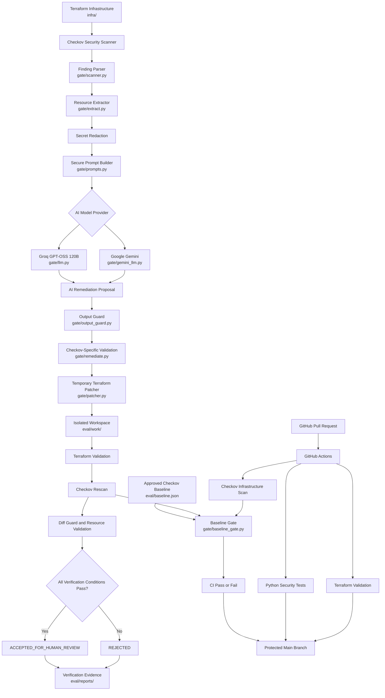

# System Architecture — AI-Assisted Terraform Security Gate

## 1. Overview

The AI-Assisted Terraform Security Gate is a Python-based infrastructure security automation system that identifies misconfigurations in Terraform infrastructure and generates AI-assisted remediation proposals.

It integrates:

- Terraform for Infrastructure as Code.
- Checkov for security scanning.
- Python for orchestration and validation.
- Groq and Google Gemini for AI remediation proposals.
- GitHub Actions for continuous integration.
- GitHub branch protection for controlled code changes.

The central architectural principle is that AI-generated Terraform changes are untrusted until independently validated.

The AI model cannot directly edit original infrastructure, execute shell commands or deploy AWS resources.

## 2. High-Level Architecture



## 3. Architectural Components

### Layer 1 — Infrastructure as Code

**Directory:** `infra/`

Contains deliberately vulnerable AWS Terraform configurations used as the security scanning target.

The infrastructure contains examples involving:

- Unrestricted SSH access.
- IMDSv1 configuration.
- S3 encryption misconfiguration.
- Public RDS accessibility.
- Wildcard IAM permissions.

These configurations provide repeatable security test cases.

The project does not require deploying these vulnerable configurations to a live AWS environment.

### Layer 2 — Security Scanner

**File:** `gate/scanner.py`

Checkov analyzes Terraform configurations and identifies security violations.

The scanner:

1. Executes Checkov against Terraform files.
2. Collects the JSON security report.
3. Parses failed security checks.
4. Converts findings into structured Python objects.
5. Extracts resource addresses, file locations, check IDs and other available metadata.

Each finding becomes structured input for subsequent remediation.

### Layer 3 — Resource Extraction and Prompt Construction

**Files:**
- `gate/extract.py`
- `gate/prompts.py`
- `gate/redaction.py`

This layer prepares a controlled input for the AI model.

The extraction engine obtains:

- Target Terraform resource block.
- Source file path.
- Relevant line numbers.
- Surrounding configuration context.

The redaction module identifies sensitive assignments and replaces recognized values with placeholders.

The prompt builder separates trusted remediation instructions from untrusted Terraform and Checkov data.

This reduces the risk of malicious source content influencing the model's trusted instructions.

### Layer 4 — AI Remediation Engine

**Files:**
- `gate/llm.py`
- `gate/gemini_llm.py`

Two AI providers are supported.

**Groq**

Model: `openai/gpt-oss-120b`

**Google Gemini**

Model used in the Day 9 evaluation: `gemini-3.6-flash`

Both providers receive a common prompt containing:

- Trusted remediation instructions.
- Target security finding.
- Extracted Terraform resource.
- Relevant source context.
- Remediation-specific requirements.

The models return structured JSON containing:

- `patched_block`
- `additional_blocks`
- `explanation`

The AI produces a proposal only. It does not apply the patch.

### Layer 5 — AI Output Security Validation

**Files:**
- `gate/output_guard.py`
- `gate/remediate.py`

Every generated proposal must pass independent application-side checks.

The system checks:

1. Required JSON structure.
2. Terraform resource identity.
3. Presence of sensitive markers.
4. Recognizable literal credentials.
5. Prohibited Terraform constructs.
6. Dangerous public ingress patterns.
7. Wildcard IAM permissions.
8. Remediation-specific security requirements.

A proposal that fails validation is rejected before patching.

### Layer 6 — Isolated Terraform Patching

**File:** `gate/patcher.py`

The patcher applies validated proposals to a separate copy of the infrastructure.

Process:

1. Validate the proposal structure.
2. Restore redacted sensitive values locally where applicable.
3. Confirm that the target resource identity is preserved.
4. Copy the original infrastructure.
5. Replace exactly the intended resource block.
6. Append permitted additional Terraform resources.

Temporary workspaces are created under:

`eval/work/`

The original infrastructure remains unchanged.

### Layer 7 — Independent Verification

**Files:**
- `gate/verify.py`
- `gate/diff_guard.py`

This is the most important trust boundary in the architecture.

The system independently verifies every patched Terraform workspace.

Verification includes:

| Verification | Purpose |
|---|---|
| Terraform fmt | Ensures Terraform formatting |
| Terraform init | Initializes providers without a backend |
| Terraform validate | Checks Terraform configuration validity |
| Checkov rescan | Rechecks infrastructure security |
| Target finding verification | Confirms the intended issue is resolved |
| New-finding comparison | Rejects newly introduced finding identities |
| File-scope validation | Restricts changes to the intended file |
| Resource-scope validation | Restricts changes to approved resources |

Acceptance requires every verification condition to pass.

The final successful decision is:

`ACCEPTED_FOR_HUMAN_REVIEW`

The project does not automatically deploy the proposed infrastructure.

### Layer 8 — Baseline-Aware Security Enforcement

**Files:**
- `gate/baseline_gate.py`
- `gate/finding_identity.py`

This layer detects security regressions.

The current Checkov findings are compared with an approved baseline.

Findings are classified as:

- New findings.
- Unchanged findings.
- Resolved findings.

The identity of a finding is based on its Checkov ID, Terraform resource and normalized file path.

Line numbers are excluded so that harmless source-line changes do not create false new findings.

The enforcement policy is:

| Finding classification | Decision |
|---|---|
| New finding | FAIL |
| Unchanged finding | PASS |
| Resolved finding | PASS |

The baseline gate also checks report completeness, parsing errors and Checkov version compatibility.

### Layer 9 — Continuous Integration and Repository Protection

**File:** `.github/workflows/terraform-security-gate.yml`

GitHub Actions executes three required jobs:

1. Python Security Tests.
2. Terraform Validation.
3. Checkov Infrastructure Scan.

The Checkov job also invokes the baseline-aware security gate.

For pull requests, the baseline is retrieved from the target branch rather than trusting a baseline modified in the pull request.

The protected `main` branch requires successful status checks and pull-request-based changes.

The implemented workflow provides automated CI verification. Automated pull-request remediation comments and production deployment are not currently implemented.

## 4. Model Evaluation Architecture

**File:** `gate/evaluate_models.py`

The evaluation engine compares Groq and Gemini against identical remediation inputs.

Five security scenarios were evaluated:

1. SSH access security.
2. EC2 IMDSv2 enforcement.
3. S3 KMS encryption.
4. RDS public accessibility.
5. IAM least-privilege permissions.

The evaluator records:

- Model and provider identifier.
- Prompt SHA-256 fingerprint.
- Generation latency.
- Proposal validation result.
- Terraform verification result.
- Checkov findings resolved.
- Newly introduced Checkov findings.
- Final acceptance decision.

The Day 9 experiment successfully verified nine proposals out of ten attempts. One Gemini RDS generation request failed due to HTTP 503 service unavailability.

The evaluation results are saved under:

`eval/reports/model-comparison/`

## 5. Repository Structure

```text
AI-Assisted Terraform Security Gate/
│
├── .github/
│   └── workflows/
│       └── terraform-security-gate.yml
│
├── infra/
│   └── Vulnerable Terraform configurations
│
├── gate/
│   ├── scanner.py
│   ├── extract.py
│   ├── prompts.py
│   ├── config.py
│   ├── llm.py
│   ├── gemini_llm.py
│   ├── remediate.py
│   ├── redaction.py
│   ├── output_guard.py
│   ├── patcher.py
│   ├── verify.py
│   ├── diff_guard.py
│   ├── finding_identity.py
│   ├── baseline_gate.py
│   └── evaluate_models.py
│
├── tests/
│   └── Unit and integration tests
│
├── eval/
│   ├── baseline.json
│   ├── proposals/
│   ├── work/
│   └── reports/
│
├── docs/
│   ├── day9-model-comparison.md
│   ├── compliance-mapping.md
│   ├── threat-model.md
│   └── architecture.md
│
├── requirements.txt
├── requirements-dev.txt
├── .gitignore
└── README.md
```

## 6. Security Design Principles

The architecture follows these principles:

**Least privilege:** CI uses read-only repository permissions.

**Separation of duties:** AI proposal generation and security verification are independent operations.

**Defense in depth:** Multiple validation layers protect against unsafe AI-generated configuration changes.

**Data minimization:** Sensitive assignments are redacted before model submission.

**Change isolation:** Terraform patches are applied to temporary infrastructure copies.

**Fail-closed verification:** Incomplete or unsuccessful verification cannot result in acceptance.

**Human oversight:** Accepted proposals remain subject to human review.

## 7. Current Limitations

The project is a security automation prototype, not a complete production cloud security platform.

Current limitations include:

- Limited coverage to selected AWS Terraform security scenarios.
- No live AWS deployment verification.
- Pattern-based rather than full HCL semantic output validation.
- Incomplete repository-wide secret discovery.
- No complete dependency SBOM.
- No automated PR remediation commenting.
- No production deployment integration.
- No formal CIS or NIST compliance assessment.

These limitations should be considered before adapting the system for enterprise production environments.

## 8. Conclusion

The AI-Assisted Terraform Security Gate combines infrastructure security scanning, AI-assisted remediation, application-side output validation, isolated patching, independent Terraform verification and baseline-aware CI enforcement.

Its central design choice is that AI-generated changes are never trusted automatically.

Every accepted proposal must pass deterministic security checks before it can be considered for human review.

This architecture demonstrates a practical application of AI within a controlled cloud infrastructure security workflow.